# LAB 004 · GitHub Markdown / Native Controls Matrix

**Experimento aislado, no aplicación ni juego.** La hipótesis es detectar controles HTML que GitHub conserve y permita operar dentro del README, sin JS ni instalaciones.

> Criterio: no basta con que se lea el HTML fuente. El control debe verse, responder a clic o tecla, y conservar la URL. Si un elemento es eliminado, esperamos ver solo los textos de fallback.

## A · Control positivo (`details`)

<details name="control-test"><summary>CONTROL_A / abrir</summary>

**A_OPENED**. Abrí el control B: si este se cierra sin recarga, son estados mutuamente exclusivos.

</details>

<details name="control-test"><summary>CONTROL_B / abrir</summary>

**B_OPENED**. Si A se cerró automáticamente, el grupo funciona.

</details>

## B · Entradas nativas (no asumir que GitHub las admite)

**Checkbox:** antes / después deben diferir solo si hay un checkbox interactivo real.

<input type="checkbox" id="matrix-check" aria-label="CHECKBOX_INTERACTIVE" /> <label for="matrix-check">CHECKBOX_TEST</label>

**Radio:** deberían cambiar entre ALPHA/BETA.

<input type="radio" name="matrix-radio" value="a" id="matrix-a" /> <label for="matrix-a">RADIO_ALPHA</label>
<input type="radio" name="matrix-radio" value="b" id="matrix-b" /> <label for="matrix-b">RADIO_BETA</label>

**Slider:** <input type="range" min="0" max="100" value="37" aria-label="RANGE_37" />

**Select:** <select aria-label="SELECT_TEST"><option value="1">FIRST_OPTION</option><option value="2">SECOND_OPTION</option></select>

**Button (inert by default):** <button type="button">BUTTON_TEST</button>

**Form:** <form><input type="text" placeholder="FORM_TEXT_TEST" /><button type="submit">FORM_SUBMIT_TEST</button></form>

## C · Rich primitives (no inline executable code should survive)

**Canvas:** <canvas width="150" height="48">CANVAS_FALLBACK_VISIBLE</canvas>

**SVG inline (should be sanitized):**

<svg xmlns="http://www.w3.org/2000/svg" width="190" height="45" viewBox="0 0 190 45" role="img" aria-label="INLINE_SVG_RENDER"><rect x="0" y="0" width="190" height="45" rx="9" fill="#35b8a2" /><text x="10" y="26" fill="#ffffff" font-size="14">SVG_RENDERED</text><animate attributeName="opacity" dur="2s" values="1;.4;1" repeatCount="indefinite"/></svg>

**Style override:** if it survives, the next sentence will be red.

<style>.matrix-custom-style { color:red!important; font-size:24px!important }</style>
<p class="matrix-custom-style">CUSTOM_STYLE_TEST</p>

**Script:** if it somehow executes, `SCRIPT_RAN` appears on the page. This is not expected.

<span id="script-output">SCRIPT_NOT_RUN</span>
<script>document.getElementById('script-output').textContent='SCRIPT_RAN';</script>

**Event handler:** <button onclick="this.textContent='ONCLICK_RAN'">ONCLICK_NOT_RUN</button>

**Open Dialog:** <dialog open>OPEN_DIALOG_TEST</dialog>

**Embedded iframe:** <iframe title="EMBED_TEST" srcdoc="<h2>IFRAME_ACTIVE</h2>">IFRAME_FALLBACK</iframe>

**Object embed:** <object data="data:text/html,%3Ch1%3EOBJECT_ACTIVE%3C%2Fh1%3E" type="text/html">OBJECT_FALLBACK</object>

**Audio:** <audio controls aria-label="AUDIO_CONTROLS_TEST"></audio>

**Video:** <video controls width="192" height="100" aria-label="VIDEO_CONTROLS_TEST">VIDEO_FALLBACK</video>

**Progress (static):** <progress value="35" max="100">PROGRESS_FALLBACK</progress>

**Meter (static):** <meter min="0" max="10" value="7">METER_FALLBACK</meter>

## D · Baseline image and code

A regular Markdown image is allowed. The existing repo does not include a custom game PNG, so this test uses native code text as a baseline.

```text
NO_JS_EXECUTION_EXPECTED
```

### QA report requirements

For each control, report **rendered DOM versus source**, if it accepts pointer/keyboard actions, and whether any JavaScript executes. Do not infer that visible text implies a retained element. In the GitHub browser, look specifically for `input`, `select`, `button`, `canvas`, `iframe`, `object`, `video`, `dialog` elements inside the rendered README.

**Importante:** no queremos burlar la seguridad de GitHub ni ejecutar código no autorizado. Queremos saber qué funcionalidades oficialmente permitidas sobreviven al renderizado.

This experiment branch is separate from main, and is **not** the public GitHub profile.

---

## E · External SVG used as an image (different from inline SVG)

This SVG is authored as a **separate asset** and embedded using normal GitHub Markdown. Its internal tests: clock-based SMIL motion, CSS hover, SMIL `begin=click`, and a checkbox inside SVG `foreignObject`.

A real interaction requires the corresponding painted object to change when users hover/click on the image, not merely a static frame or an animation that plays by itself.



**E acceptance table (do not infer results from the source):**

| Behavior | Required evidence |
| --- | --- |
| Timeline animation | Green circle changes x position without clicking |
| Hover | Purple square changes fill color when pointer enters it |
| Click | Orange circle grows *after direct click on the circle* |
| Embedded form | Checkbox responds to input and updates label |
| Game-state computation | Actual controlled state transition and rules (not present in probe) |

SVG displayed as an image may animate but be non-interactive according to browser secure static image document mode. This is intentionally a behavioral test, not a claim that SVG can be an embedded game.

---

## F · Keyboard accessibility and document-native editing

**Goal:** determine whether GitHub preserves native `accesskey`, `tabindex`, `contenteditable`, and `draggable` attributes in an ordinary README. These are not scripts, but the sanitizer may remove them.

<details>
<summary accesskey="g" tabindex="0">ACCESSKEY_G · ALT+SHIFT+G on Chrome/Windows</summary>

**ACCESSKEY_G_OPENED**. Verify whether the keyboard shortcut actually toggled this panel without a mouse click; mere disclosure ability is a different test.

</details>

<details>
<summary tabindex="0">TAB_TO_SUMMARY · then press SPACE or ENTER</summary>

**KEYBOARD_SUMMARY_TOGGLED**. Standard native keyboard accessibility, not a WASD loop.

</details>

**Contenteditable experiment:**

<p contenteditable="true" spellcheck="false">EDITABLE_TEXT_START: CAN YOU TYPE HERE?</p>

**Native draggable experiment:** <span draggable="true">DRAGGABLE_TOKEN</span>

### accesskey-target

An ordinary heading anchor is the fallback. If pressing Alt+Shift+G does nothing, this section won't help create keyboard game controls.

**Security boundary:** all tests remain on a separately rendered public experiment branch, and do not target or circumvent site scripts.
