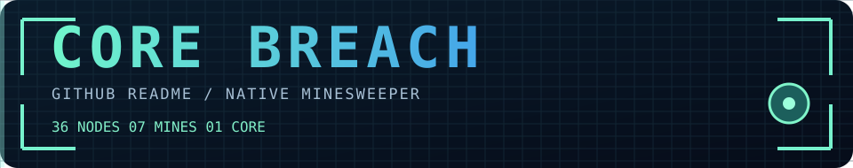

<!-- NATIVE README GAME. 36 INDEPENDENT DETAILS, NO SCRIPTS. EXPERIMENTAL ONLY. -->

### DEFUSE THE GRID

**07 minas · 29 casillas seguras · 00 instalaciones · 00 redirecciones**

Una cuadrícula real con minas y números calculados a partir de una distribución fija. **Hacé clic sobre cada nodo para descubrirlo.** El número indica cuántas minas hay en las ocho casillas vecinas. Evitá todas las minas y abrí los 29 nodos seguros para superar el desafío.

| 01 | 02 | 03 | 04 | 05 | 06 |
| :--: | :--: | :--: | :--: | :--: | :--: |
| 

<strong>✓</strong>
 | 

<strong>2</strong>
 | 

<strong>💥 MINA</strong>
 | 

<strong>3</strong>
 | 

<strong>1</strong>
 | 

<strong>1</strong>
 |
| 

<strong>✓</strong>
 | 

<strong>2</strong>
 | 

<strong>💥 MINA</strong>
 | 

<strong>3</strong>
 | 

<strong>💥 MINA</strong>
 | 

<strong>1</strong>
 |
| 

<strong>1</strong>
 | 

<strong>2</strong>
 | 

<strong>2</strong>
 | 

<strong>2</strong>
 | 

<strong>1</strong>
 | 

<strong>1</strong>
 |
| 

<strong>1</strong>
 | 

<strong>💥 MINA</strong>
 | 

<strong>2</strong>
 | 

<strong>1</strong>
 | 

<strong>1</strong>
 | 

<strong>✓</strong>
 |
| 

<strong>2</strong>
 | 

<strong>2</strong>
 | 

<strong>3</strong>
 | 

<strong>💥 MINA</strong>
 | 

<strong>2</strong>
 | 

<strong>1</strong>
 |
| 

<strong>1</strong>
 | 

<strong>💥 MINA</strong>
 | 

<strong>2</strong>
 | 

<strong>2</strong>
 | 

<strong>💥 MINA</strong>
 | 

<strong>1</strong>
 |

◈ AYUDA / REGLAS

- **1–8**: cantidad de minas adyacentes, incluyendo diagonales.
- **✓**: casilla libre de minas vecinas.
- **💥 MINA**: pisaste una mina. La partida termina según las reglas; el HTML no puede desactivar otros clics.
- **Reiniciar:** F5. No se registran estadísticas ni se compara automáticamente el número de casillas seguras.
- **Limitación del prototipo:** sin banderas, autodespeje, cronómetro, victoria automática ni bloqueo tras derrota. Es un **minijuego de revelación y deducción**, no un motor de física.

GitHub native / GFM table + HTML details + SVG graphics. El navegador no ejecuta código del autor. Esta rama es experimental y no es el README de `chrishotza`.
